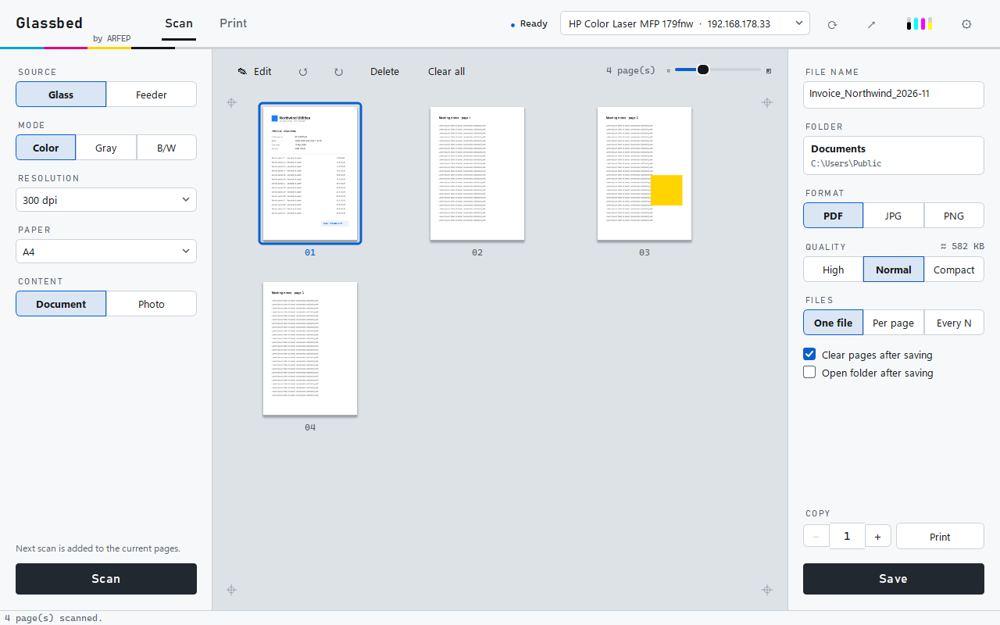
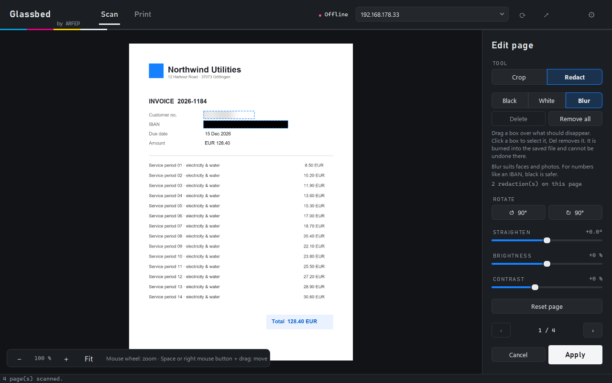
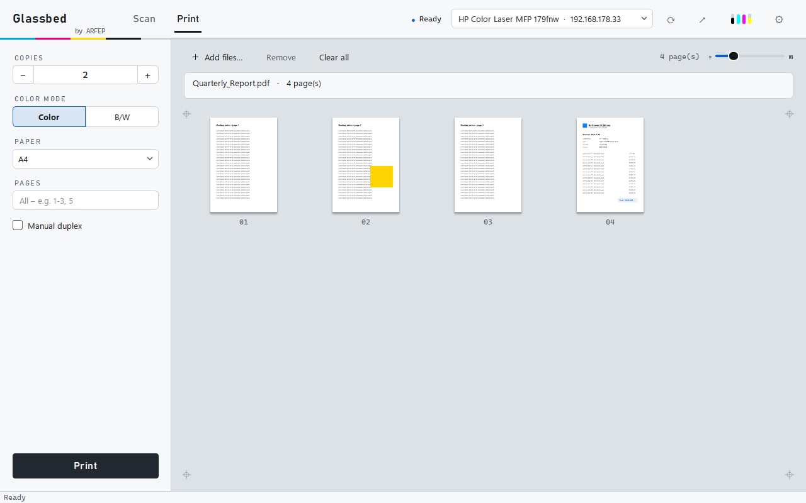

<div align="center">

# Glassbed

**Scannen und Drucken am Netzwerkdrucker – ohne Herstellersoftware, ohne Treiber.**

[English](README.md) · [Deutsch](README.de.md) · [Türkçe](README.tr.md)

[](LICENSE)


Ein Open-Source-Projekt von [ARFEP IT-Service](https://arfep.de) · Göttingen

<picture>
  <source media="(prefers-color-scheme: dark)" srcset="docs/screenshots/scan-dark.png">
  
</picture>

</div>

---

Glassbed spricht direkt über das Netzwerk mit deinem Multifunktionsdrucker – über die offenen
Standards, die viele moderne Geräte unterstützen: **eSCL (AirScan)** zum Scannen und
**IPP (AirPrint)** zum Drucken. Keine Installation am Drucker, keine Hintergrunddienste, kein Konto.

Glassbed ist als schlanke Alternative zur offiziellen App für den **HP Color Laser MFP 178/179**
entstanden – und sollte mit vielen Netzwerkdruckern funktionieren, die eSCL und IPP unterstützen.

## Funktionen

**Scannen**
- Glas oder Vorlageneinzug (ADF), Farbe / Grau / Schwarzweiß, 100–300 dpi
- Die Seiten liegen auf einem virtuellen Scannerglas: per Drag & Drop sortieren, drehen, löschen
- Vorschaugröße einstellbar (Schieberegler oder <kbd>Strg</kbd> + Mausrad)

**Jede Seite bearbeiten**
- Zuschneiden – Rahmen ziehen, oder **Automatisch** findet einen Kassenbon auf dem Glas
- Drehen, schiefe Scans begradigen, Helligkeit und Kontrast
- **Schwärzen** mit schwarzen, weißen oder unscharfen Rechtecken – verschieben, Größe ändern, mit Pfeiltasten justieren
- Hineinzoomen bis zur Originalauflösung für genaues Arbeiten
- Bis zum Speichern nicht endgültig: jede Seite lässt sich neu bearbeiten oder zurücksetzen

**Speichern**
- Ein PDF, ein PDF pro Seite oder ein PDF je *N* Seiten – oder JPG / PNG
- Qualität *Hoch / Normal / Kompakt* mit Live-Schätzung der Dateigröße (*Kompakt* meist 5–10× kleiner)
- Deutliche Bestätigung mit *Öffnen* und *Im Ordner zeigen*; unveränderte Seiten werden nie doppelt gespeichert
- Rückfrage beim Schließen, wenn Scans noch nicht gespeichert sind

**Drucken & Kopieren**
- PDFs oder Bilder hineinziehen, Kopien, Farbe oder S/W, Papierformat und Seitenbereich wählen
- Manueller Duplex für Drucker ohne Duplexeinheit
- Kopieren: scannen und in Originalgröße drucken

**App**
- Findet Drucker automatisch (Bonjour/mDNS), oder IP-Adresse eintippen
- Druckerstatus und Tonerstand in der Kopfzeile
- Deutsch, Englisch und Türkisch · helles, dunkles oder System-Design
- Ein Fenster: Editor, Einstellungen und Meldungen bleiben darin; ein zweiter Start nutzt das vorhandene Fenster
- Optional, standardmäßig aus: Symbol im Infobereich mit **Schnell-Scan**, Toner-Warnung
  (unter 15 %, je Farbe höchstens einmal am Tag) und *Mit Windows starten*
- Kommandozeile für Skripte

<table>
  <tr>
    <td></td>
    <td></td>
  </tr>
  <tr>
    <td align="center"><sub>Sensible Daten schwärzen – fest in die Datei eingebrannt</sub></td>
    <td align="center"><sub>PDFs und Bilder per Drag &amp; Drop drucken</sub></td>
  </tr>
</table>

## Installation

### Windows

**Installer (empfohlen):** Lade `Glassbed-<version>-setup.exe` von der Seite
[Releases](../../releases/latest) herunter und starte ihn per Doppelklick. Er installiert nur für
dein Benutzerkonto – **ohne Administratorrechte** – nach `%LOCALAPPDATA%\Programs\Glassbed` und legt
einen Eintrag im Startmenü an; Desktop-Verknüpfung und *Mit Windows starten* sind optional.
Deinstallieren über *Einstellungen → Apps*; deine Einstellungen bleiben erhalten.

**Portable ZIP:** Lade `Glassbed-<version>-windows-portable.zip` herunter, entpacke sie und starte
**`Glassbed.exe`**. Lass den Ordner zusammen – die `.exe` braucht die Dateien daneben.

Beide sind noch nicht signiert (siehe [Code-Signing-Richtlinie](CODE_SIGNING_POLICY.md)), daher
kann Windows SmartScreen warnen. Die Lizenzen der mitgelieferten Komponenten sind in
`THIRD_PARTY_NOTICES.md` aufgeführt; ihre vollständigen Texte stehen im Ordner `licenses/`.

### Aus dem Quellcode (Windows, macOS, Linux)

Benötigt Python 3.10 oder neuer.

```bash
git clone https://github.com/ARFEP-IT-Service/Glassbed.git
cd Glassbed
pip install .
glassbed
```

Oder ohne Installation starten:

```bash
pip install -r requirements.txt
python -m glassbed
```

### Windows-App selbst bauen

Für den Installer wird [Inno Setup 6](https://jrsoftware.org/isinfo.php) benötigt.

```powershell
pip install -e ".[dev]"
./build.ps1          # → dist/Glassbed-<version>-setup.exe und dist/Glassbed-<version>-windows-portable.zip
```

## Erste Schritte

1. Glassbed starten. Es sucht im Netzwerk und wählt deinen Drucker; findet es keinen, trage die
   IP-Adresse des Druckers oben ins Feld ein.
2. **Scannen:** links Quelle, Modus und Auflösung wählen, **Scannen** klicken. Weitere Scans werden
   an dasselbe Dokument angehängt.
3. **Bearbeiten** (optional): Seite doppelklicken, um sie zuzuschneiden, zu begradigen oder zu schwärzen.
4. **Speichern:** rechts Dateiname, Ordner, Format und Qualität wählen, **Speichern** klicken.
5. **Drucken:** zu *Drucken* wechseln, Dateien ins Fenster ziehen, **Drucken** klicken.

## Tastenkürzel

| Wo | Tasten | Aktion |
|---|---|---|
| Scan-Tab | <kbd>Strg</kbd>+<kbd>S</kbd> | Speichern |
| Scan-Tab | <kbd>Entf</kbd> | Ausgewählte Seiten löschen |
| Seitenübersicht | <kbd>Strg</kbd> + Mausrad | Vorschau größer / kleiner |
| Editor | Mausrad · <kbd>+</kbd> <kbd>−</kbd> · <kbd>0</kbd> | Zoomen · ganze Seite |
| Editor | <kbd>Leertaste</kbd> oder rechte Maustaste + ziehen | Gezoomte Seite verschieben |
| Editor | <kbd>C</kbd> · <kbd>S</kbd> | Zuschneiden · Schwärzen |
| Editor | <kbd>←</kbd><kbd>→</kbd><kbd>↑</kbd><kbd>↓</kbd> (+ <kbd>Umschalt</kbd>) | Ausgewählte Schwärzung verschieben |
| Editor | <kbd>Entf</kbd> | Ausgewählte Schwärzung löschen |
| Editor | <kbd>Bild ↑</kbd> / <kbd>Bild ↓</kbd> | Vorherige / nächste Seite |
| Editor | <kbd>Strg</kbd>+<kbd>Z</kbd> | Seite zurücksetzen |
| Editor, Einstellungen, Vorschau | <kbd>Esc</kbd> | Zurück |

## Kommandozeile

```bash
glassbed-cli list                                   # Geräte suchen
glassbed-cli --host 192.168.1.20 status             # Status und Toner
glassbed-cli --host 192.168.1.20 scan brief.pdf --adf --mode gray --quality compact
glassbed-cli --host 192.168.1.20 scan seiten.pdf --adf --split 1    # ein PDF pro Seite
glassbed-cli --host 192.168.1.20 print bericht.pdf --copies 2 --mono --pages 1-3
```

Ohne Installation `python -m glassbed …` statt `glassbed-cli` verwenden.

## Datenschutz & Sicherheit

- Glassbed spricht nur mit **deinem Drucker** im lokalen Netzwerk. Keine Cloud, kein Konto,
  keine Telemetrie. Webseiten öffnen sich nur, wenn du sie anklickst (Drucker-Webseite, arfep.de).
- **Schwärzungen werden eingebrannt.** Die verdeckten Pixel werden ersetzt, bevor die Seite
  gedreht, zugeschnitten oder gespeichert wird – darunter liegt keine versteckte Ebene, die man
  freilegen könnte. Für Zahlen wie eine IBAN *Schwarz* verwenden; *Unscharf* ist für Gesichter und Fotos gedacht.
- Scans bleiben bis zum Speichern im Arbeitsspeicher; das Original bleibt erhalten, damit sich
  Bearbeitungen in der App rückgängig machen lassen.

## Kompatibilität

| Gerät | Scannen | Drucken | Hinweise |
|---|---|---|---|
| HP Color Laser MFP 179fnw (Firmware V3.82) | ✅ Glas, Grau/Farbe/S/W | ✅ Drucker nimmt Aufträge an | S/W über Graustufen (Gerät lehnt 1-Bit-JPEG ab), max. 300 dpi, kein automatischer Duplex |

Jedes Gerät mit **AirScan/eSCL** (Scannen) und **AirPrint/IPP** mit Apple-Raster (`image/urf`)
oder JPEG (Drucken) sollte funktionieren. Bitte melde dein Modell – siehe [Mitwirken](#mitwirken).

## So funktioniert's

| Funktion | Protokoll | Code |
|---|---|---|
| Gerätesuche | mDNS `_uscan._tcp`, `_ipp._tcp` | [`discovery.py`](glassbed/discovery.py) |
| Scannen | eSCL über HTTP (`/eSCL/ScanJobs`) | [`escl.py`](glassbed/escl.py) |
| Drucken | IPP/2.0 `Print-Job` mit Apple-Raster | [`ipp.py`](glassbed/ipp.py), [`urf.py`](glassbed/urf.py) |
| Rendern | PDFium für PDFs, Pillow für Bilder | [`render.py`](glassbed/render.py) |
| Seitenbearbeitung | Zuschneiden, Begradigen, Schwärzen (nicht destruktiv) | [`edit.py`](glassbed/edit.py) |
| Oberfläche | Qt (PySide6) | [`gui/`](glassbed/gui) |

Viele Drucker – auch der HP 178/179 – nehmen über das Netzwerk kein PDF an. Glassbed rechnet
deshalb jede Seite selbst in ein Rasterbild um und sendet sie als Apple-Raster.

## Fehlerbehebung

- **Drucker wird nicht gefunden:** IP-Adresse eintragen, die das Druckerdisplay oder der
  Netzwerkbericht anzeigt. Manche Router und VPNs blockieren mDNS.
- **„Nicht erreichbar“:** prüfen, ob sich `http://<drucker-ip>/` im Browser öffnet und ob
  AirPrint/eSCL in der Weboberfläche des Druckers aktiviert ist.
- **„Der Scanner ist beschäftigt“:** ein anderer Computer oder das Bedienfeld des Druckers scannt
  gerade – gleich noch einmal versuchen.
- **Etwas ausprobieren, ohne die eigenen Einstellungen zu ändern:** `GLASSBED_PROFILE=Glassbed-dev`
  (beliebiger Name) setzen, dann startet Glassbed mit einem eigenen Einstellungsprofil.

## Mitwirken

Fehlerberichte, Druckermeldungen, Übersetzungen und Pull Requests sind willkommen.
Siehe [CONTRIBUTING.md](CONTRIBUTING.md) – kurz:

```bash
pip install -e ".[dev]"
pytest
python -m pyflakes glassbed tests
```

Für eine neue Sprache reicht eine Tabelle in [`glassbed/i18n.py`](glassbed/i18n.py); fehlende
Einträge erscheinen auf Englisch.

## Lizenz

[MIT](LICENSE) – © 2026 Halil Ayberk Bulut (ARFEP IT-Service) und Glassbed-Mitwirkende.

Die Windows-Version enthält Komponenten von Drittanbietern unter deren eigenen Lizenzen – siehe
[THIRD_PARTY_NOTICES.md](THIRD_PARTY_NOTICES.md); die vollständigen Texte stehen in [`licenses/`](licenses).
Wie Windows-Versionen signiert werden: [CODE_SIGNING_POLICY.md](CODE_SIGNING_POLICY.md).

Das ARFEP-Logo in [`glassbed/assets/arfep/`](glassbed/assets/arfep/NOTICE.md) fällt **nicht** unter
die MIT-Lizenz; Forks ohne Verbindung zu ARFEP IT-Service müssen es entfernen oder ersetzen.

HP ist eine Marke von HP Inc. AirPrint und Bonjour sind Marken von Apple Inc.
Microsoft 365 ist eine Marke der Microsoft Corporation. Glassbed steht in keiner Verbindung zu
HP, Apple oder Microsoft und wird von diesen nicht unterstützt.

## IT-Hilfe gesucht?

Glassbed kommt von **[ARFEP IT-Service](https://arfep.de)** – Netzwerk, Drucker, Server,
Backup und Microsoft 365, in Göttingen und per Fernwartung bundesweit.

Impressum / Legal notice: [arfep.de/impressum](https://arfep.de/impressum)
