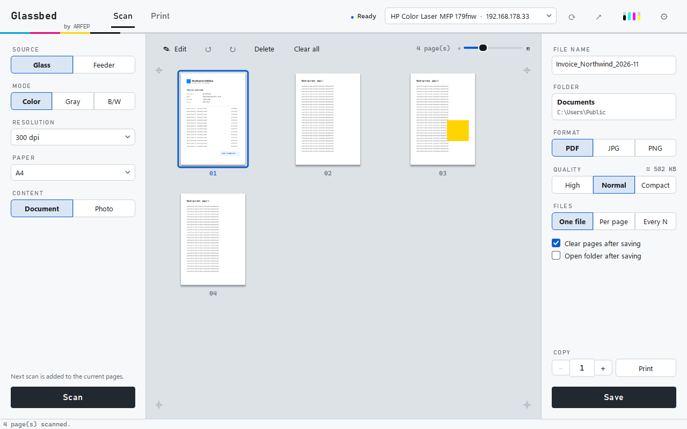
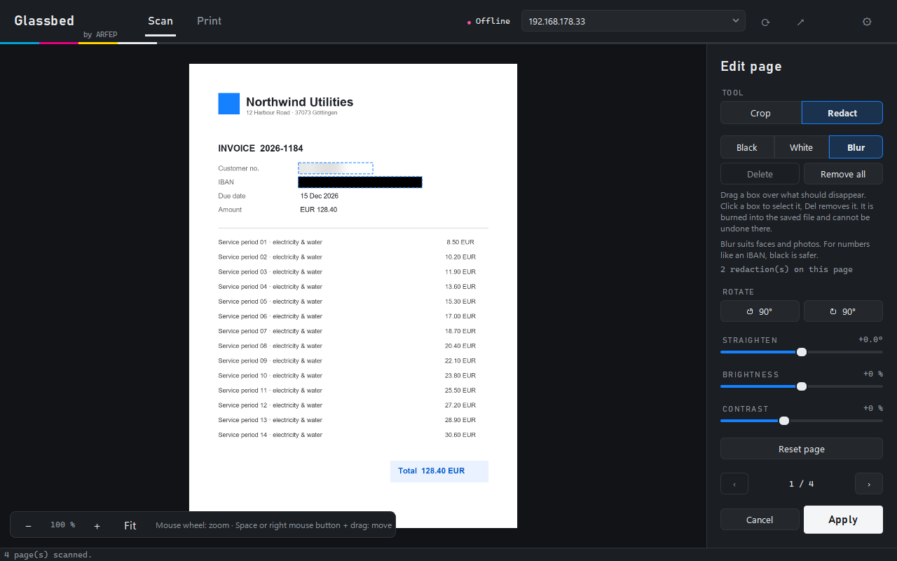
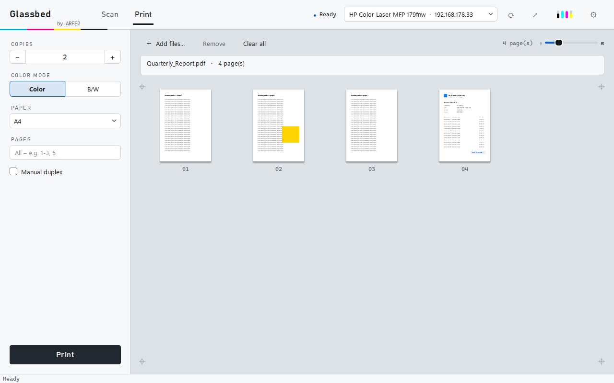

<div align="center">

# Glassbed

**Scan and print on your network printer – no vendor software, no drivers.**

[English](README.md) · [Deutsch](README.de.md) · [Türkçe](README.tr.md)

[](LICENSE)


An open-source project by [ARFEP IT-Service](https://arfep.de) · Göttingen

<picture>
  <source media="(prefers-color-scheme: dark)" srcset="docs/screenshots/scan-dark.png">
  
</picture>

</div>

---

Glassbed talks to your multifunction printer directly over the network, using the open
standards that many modern devices support: **eSCL (AirScan)** for scanning and **IPP (AirPrint)**
for printing. Nothing to install on the printer side, no background services, no account.

It was built as a lightweight alternative to the official app for the **HP Color Laser MFP 178/179** –
and should work with many network printers that support eSCL and IPP.

## Features

**Scan**
- Glass or document feeder (ADF), color / gray / black & white, 100–300 dpi
- Pages land on a virtual scanner glass: reorder by drag & drop, rotate, delete
- Adjustable preview size (slider or <kbd>Ctrl</kbd> + mouse wheel)

**Edit each page**
- Crop – drag the frame, or **Auto** finds a receipt lying on the glass
- Rotate, straighten crooked scans, brightness and contrast
- **Redact** with black, white or blur boxes – move and resize them, nudge with the arrow keys
- Zoom in to the original resolution for precise work
- Non-destructive until you save: every page can be re-edited or reset

**Save**
- One PDF, one PDF per page, or one PDF every *N* pages – or JPG / PNG
- Quality *High / Normal / Compact* with a live size estimate (*Compact* is typically 5–10× smaller)
- Clear confirmation with *Open* and *Show in folder*; unchanged pages are never saved twice
- Asks before closing when scans haven't been saved

**Print & copy**
- Drop PDFs or images in, choose copies, color or B/W, paper size and page range
- Manual duplex for printers without a duplex unit
- Copy: scan and print at actual size

**App**
- Finds printers automatically (Bonjour/mDNS), or type the IP address
- Printer status and toner levels in the header
- English, German and Turkish · light, dark or system theme
- One window: editor, settings and messages stay inside it; starting Glassbed again reuses it
- Optional, off by default: icon in the notification area with **Quick scan**, a toner warning
  (below 15 %, at most once a day per colour) and *Start with Windows*
- Command line interface for scripts

<table>
  <tr>
    <td></td>
    <td></td>
  </tr>
  <tr>
    <td align="center"><sub>Redact sensitive data – burned into the saved file</sub></td>
    <td align="center"><sub>Print PDFs and images by drag &amp; drop</sub></td>
  </tr>
</table>

## Installation

### Windows

**Installer (recommended):** download `Glassbed-<version>-setup.exe` from the
[Releases](../../releases/latest) page and double-click it. It installs for your user account
only – **no administrator rights needed** – into `%LOCALAPPDATA%\Programs\Glassbed` and adds a
Start menu entry; a desktop shortcut and *Start with Windows* are optional. Uninstall via
*Settings → Apps*; your settings are kept.

**Portable ZIP:** download `Glassbed-<version>-windows-portable.zip`, unzip it and start
**`Glassbed.exe`**. Keep the whole folder together – the `.exe` needs the files next to it.

Both are not code-signed yet (see [verifying downloads](VERIFYING.md)), so Windows
SmartScreen may show a warning. The licenses of the bundled components are listed in
`THIRD_PARTY_NOTICES.md`; their full texts are in the `licenses/` folder.

### From source (Windows, macOS, Linux)

Requires Python 3.10 or newer.

```bash
git clone https://github.com/ARFEP-IT-Service/Glassbed.git
cd Glassbed
pip install .
glassbed
```

Or run it without installing:

```bash
pip install -r requirements.txt
python -m glassbed
```

### Build the Windows app yourself

Requires exactly the Python version in `.python-version`. `build.ps1` creates a fresh virtual
environment from the pinned `build-requirements.txt` and downloads the pinned NSIS version.

```powershell
./build.ps1          # → dist/Glassbed-<version>-setup.exe and dist/Glassbed-<version>-windows-portable.zip
```

## Getting started

1. Start Glassbed. It searches the network and picks your printer; if it doesn't find one,
   type the printer's IP address into the field at the top.
2. **Scan:** choose source, mode and resolution on the left, click **Scan**. Further scans are
   added to the same document.
3. **Edit** (optional): double-click a page to crop, straighten or redact it.
4. **Save:** pick file name, folder, format and quality on the right, click **Save**.
5. **Print:** switch to *Print*, drop files into the window, click **Print**.

## Keyboard shortcuts

| Where | Keys | Action |
|---|---|---|
| Scan tab | <kbd>Ctrl</kbd>+<kbd>S</kbd> | Save |
| Scan tab | <kbd>Del</kbd> | Delete selected pages |
| Page grids | <kbd>Ctrl</kbd> + mouse wheel | Larger / smaller previews |
| Editor | mouse wheel · <kbd>+</kbd> <kbd>−</kbd> · <kbd>0</kbd> | Zoom · whole page |
| Editor | <kbd>Space</kbd> or right mouse button + drag | Move the zoomed page |
| Editor | <kbd>C</kbd> · <kbd>S</kbd> | Crop tool · Redact tool |
| Editor | <kbd>←</kbd><kbd>→</kbd><kbd>↑</kbd><kbd>↓</kbd> (+ <kbd>Shift</kbd>) | Nudge the selected redaction |
| Editor | <kbd>Del</kbd> | Remove the selected redaction |
| Editor | <kbd>Page Up</kbd> / <kbd>Page Down</kbd> | Previous / next page |
| Editor | <kbd>Ctrl</kbd>+<kbd>Z</kbd> | Reset the page |
| Editor, settings, preview | <kbd>Esc</kbd> | Back |

## Command line

```bash
glassbed-cli list                                   # find devices
glassbed-cli --host 192.168.1.20 status             # state and toner
glassbed-cli --host 192.168.1.20 scan letter.pdf --adf --mode gray --quality compact
glassbed-cli --host 192.168.1.20 scan pages.pdf --adf --split 1     # one PDF per page
glassbed-cli --host 192.168.1.20 print report.pdf --copies 2 --mono --pages 1-3
```

Without installing, use `python -m glassbed …` instead of `glassbed-cli`.

## Privacy & security

- Glassbed only talks to **your printer** in your local network. No cloud, no account,
  no telemetry. The only web pages it opens are the ones you click (printer web page, arfep.de).
- **Redactions are burned in.** The covered pixels are replaced before the page is rotated,
  cropped or saved – there is no hidden layer underneath that could be uncovered. For numbers
  such as an IBAN, use *Black*; *Blur* is meant for faces and photos.
- Scans stay in memory until you save them; the original is kept so edits can be undone
  inside the app.

## Compatibility

| Device | Scan | Print | Notes |
|---|---|---|---|
| HP Color Laser MFP 179fnw (firmware V3.82) | ✅ glass, gray/color/B&W | ✅ printer accepts jobs | B&W via grayscale (device rejects 1-bit JPEG), max 300 dpi, no automatic duplex |

Any device that supports **AirScan/eSCL** (scanning) and **AirPrint/IPP** with Apple raster
(`image/urf`) or JPEG (printing) should work. Please report your model – see
[Contributing](#contributing).

## How it works

| Function | Protocol | Code |
|---|---|---|
| Discovery | mDNS `_uscan._tcp`, `_ipp._tcp` | [`discovery.py`](glassbed/discovery.py) |
| Scanning | eSCL over HTTP (`/eSCL/ScanJobs`) | [`escl.py`](glassbed/escl.py) |
| Printing | IPP/2.0 `Print-Job` with Apple raster | [`ipp.py`](glassbed/ipp.py), [`urf.py`](glassbed/urf.py) |
| Rendering | PDFium for PDFs, Pillow for images | [`render.py`](glassbed/render.py) |
| Page edits | crop, straighten, redact (non-destructive) | [`edit.py`](glassbed/edit.py) |
| User interface | Qt (PySide6) | [`gui/`](glassbed/gui) |

Many printers – including the HP 178/179 – do not accept PDF over the network, so Glassbed
rasterizes every page itself and sends it as Apple raster.

## Troubleshooting

- **Printer not found:** enter the IP address shown on the printer's display or network
  report. Some routers and VPNs block mDNS.
- **"Offline":** check that `http://<printer-ip>/` opens in a browser and that AirPrint/eSCL is
  enabled in the printer's web interface.
- **"The scanner is busy":** another computer or the printer's own panel is scanning – try
  again in a moment.
- **Try something without touching your settings:** set `GLASSBED_PROFILE=Glassbed-dev`
  (any name) to start with a separate settings profile.

## Contributing

Bug reports, printer reports, translations and pull requests are welcome.
See [CONTRIBUTING.md](CONTRIBUTING.md) – in short:

```bash
pip install -e ".[dev]"
pytest
python -m pyflakes glassbed tests
```

New languages need one table in [`glassbed/i18n.py`](glassbed/i18n.py); missing entries fall
back to English.

## License

[MIT](LICENSE) – © 2026 Halil Ayberk Bulut (ARFEP IT-Service) and Glassbed contributors.

The Windows build bundles third-party components under their own licenses – see
[THIRD_PARTY_NOTICES.md](THIRD_PARTY_NOTICES.md); their full texts are in [`licenses/`](licenses).
How to verify Windows downloads: [VERIFYING.md](VERIFYING.md).

The ARFEP logo in [`glassbed/assets/arfep/`](glassbed/assets/arfep/NOTICE.md) is **not** part
of the MIT license; forks that are not affiliated with ARFEP IT-Service must remove or replace it.

HP is a trademark of HP Inc. AirPrint and Bonjour are trademarks of Apple Inc.
Microsoft 365 is a trademark of Microsoft Corporation. Glassbed is not affiliated with or
endorsed by HP, Apple or Microsoft.

## Need help with IT?

Glassbed is made by **[ARFEP IT-Service](https://arfep.de)** – networks, printers, servers,
backup and Microsoft 365, in Göttingen and remotely across Germany.

Impressum / Legal notice: [arfep.de/impressum](https://arfep.de/impressum)
