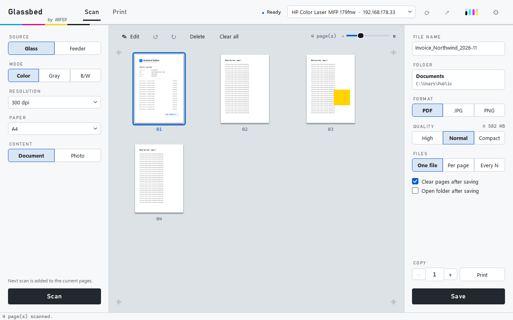
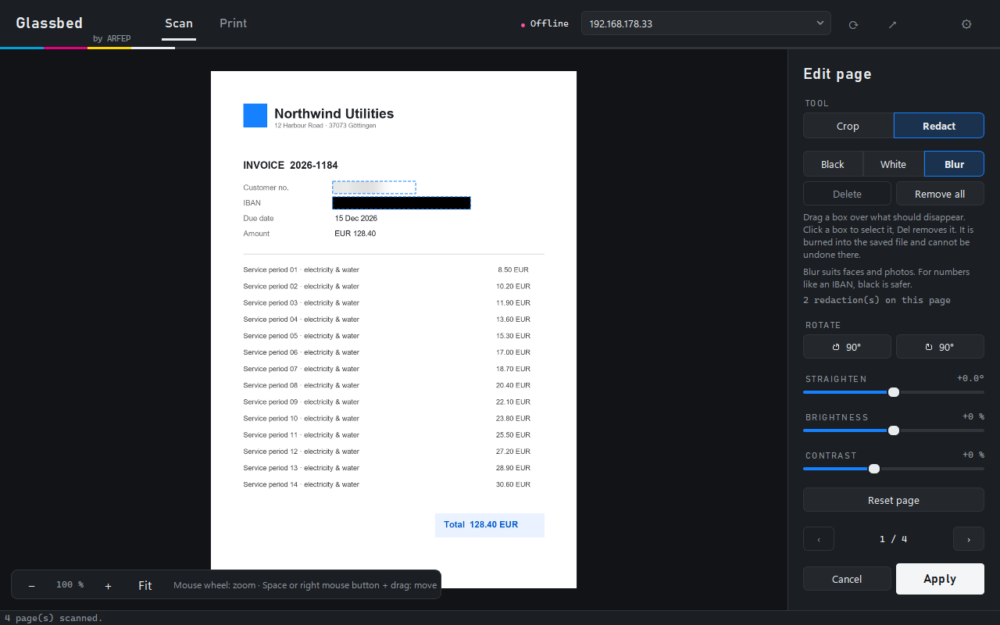
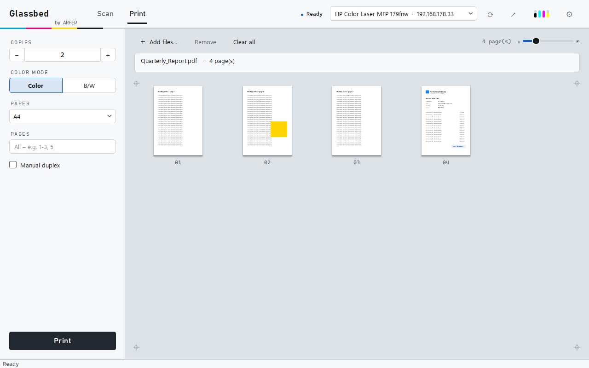

<div align="center">

# Glassbed

**Ağ yazıcınızla tarayın ve yazdırın – üretici yazılımı yok, sürücü yok.**

[English](README.md) · [Deutsch](README.de.md) · [Türkçe](README.tr.md)

[](LICENSE)


[ARFEP IT-Service](https://arfep.de) · Göttingen tarafından geliştirilen açık kaynaklı bir proje

<picture>
  <source media="(prefers-color-scheme: dark)" srcset="docs/screenshots/scan-dark.png">
  
</picture>

</div>

---

Glassbed, çok işlevli yazıcınızla ağ üzerinden doğrudan konuşur ve birçok modern cihazın desteklediği
açık standartları kullanır: tarama için **eSCL (AirScan)**, yazdırma için **IPP (AirPrint)**.
Yazıcıya kurulum yok, arka plan servisi yok, hesap yok.

Glassbed, **HP Color Laser MFP 178/179** için resmi uygulamaya hafif bir alternatif olarak
geliştirildi – ve eSCL ile IPP'yi destekleyen birçok ağ yazıcısıyla çalışması beklenir.

## Özellikler

**Tarama**
- Cam veya belge besleyici (ADF), renkli / gri / siyah-beyaz, 100–300 dpi
- Sayfalar sanal bir tarayıcı camına düşer: sürükle-bırak ile sırala, döndür, sil
- Önizleme boyutu ayarlanabilir (kaydırıcı veya <kbd>Ctrl</kbd> + fare tekerleği)

**Her sayfayı düzenleme**
- Kırpma – çerçeveyi sürükleyin veya **Otomatik** camdaki fişi bulsun
- Döndürme, eğik taramaları düzeltme, parlaklık ve kontrast
- Siyah, beyaz veya bulanık kutularla **karartma** – taşıyın, boyutlandırın, ok tuşlarıyla ince ayar yapın
- Hassas çalışma için orijinal çözünürlüğe kadar yakınlaştırma
- Kaydedene kadar kalıcı değil: her sayfa yeniden düzenlenebilir veya sıfırlanabilir

**Kaydetme**
- Tek PDF, sayfa başına bir PDF veya her *N* sayfada bir PDF – ya da JPG / PNG
- *Yüksek / Normal / Kompakt* kalite ve anlık dosya boyutu tahmini (*Kompakt* genellikle 5–10 kat daha küçük)
- *Aç* ve *Klasörde göster* düğmeleriyle net bir onay; değişmemiş sayfalar asla iki kez kaydedilmez
- Kaydedilmemiş taramalar varken kapatmadan önce sorar

**Yazdırma ve kopyalama**
- PDF veya resimleri sürükleyip bırakın; kopya sayısı, renkli veya S/B, kâğıt boyutu ve sayfa aralığı seçin
- Dupleks ünitesi olmayan yazıcılar için elle çift taraflı yazdırma
- Kopyalama: tarayın ve gerçek boyutta yazdırın

**Uygulama**
- Yazıcıları otomatik bulur (Bonjour/mDNS) veya IP adresini yazın
- Üst çubukta yazıcı durumu ve toner seviyeleri
- Türkçe, Almanca ve İngilizce · açık, koyu veya sistem teması
- Tek pencere: düzenleyici, ayarlar ve mesajlar pencerenin içinde kalır; Glassbed'i yeniden başlatmak mevcut pencereyi kullanır
- İsteğe bağlı, varsayılan olarak kapalı: **Hızlı tarama** içeren bildirim alanı simgesi, toner uyarısı
  (%15'in altında, renk başına günde en fazla bir kez) ve *Windows ile başlat*
- İsteğe bağlı, varsayılan olarak kapalı: GitHub üzerinden güncelleme denetimi – yeni sürümleri
  bildirir ve indirmeyi tarayıcınızda açar
- Betikler için komut satırı arayüzü

<table>
  <tr>
    <td></td>
    <td></td>
  </tr>
  <tr>
    <td align="center"><sub>Hassas verileri karartın – kaydedilen dosyaya kalıcı olarak işlenir</sub></td>
    <td align="center"><sub>PDF ve resimleri sürükle-bırak ile yazdırın</sub></td>
  </tr>
</table>

## Kurulum

### Windows

**Kurulum programı (önerilen):** [Releases](../../releases/latest) sayfasından
`Glassbed-<version>-setup.exe` dosyasını indirin ve çift tıklayın. Yalnızca kendi kullanıcı hesabınız
için – **yönetici hakları gerekmeden** – `%LOCALAPPDATA%\Programs\Glassbed` klasörüne kurar ve Başlat
menüsüne bir kayıt ekler; masaüstü kısayolu ve *Windows ile başlat* isteğe bağlıdır. Kaldırmak için
*Ayarlar → Uygulamalar*; ayarlarınız korunur.

**Taşınabilir ZIP:** `Glassbed-<version>-windows-portable.zip` dosyasını indirin, açın ve
**`Glassbed.exe`** dosyasını başlatın. Klasörü bir arada tutun – `.exe` yanındaki dosyalara ihtiyaç duyar.

İkisi de henüz imzalı değildir (bkz. [indirilen dosyaları doğrulama](VERIFYING.md)); bu yüzden
Windows SmartScreen uyarı gösterebilir. Birlikte gelen bileşenlerin lisansları
`THIRD_PARTY_NOTICES.md` dosyasında listelenmiştir; tam metinleri `licenses/` klasöründedir.

### Güncellemeler

*Güncellemeleri denetle* açıksa (bkz. [Gizlilik ve güvenlik](#gizlilik-ve-güvenlik)), yeni bir
sürüm çıktığında Glassbed pencerede bir bildirim şeridi gösterir: *Güncelle · Yenilikler · Sonra ·
Bu sürümü atla*; bildirim alanı simgesi etkinse ayrıca bir Windows bildirimi.

Glassbed hiçbir zaman kendisi program indirmez veya başlatmaz – *Güncelle* tarayıcınızı açar:

- **Kurulum programıyla kurulduysa (Windows):** tarayıcı yeni `Glassbed-<version>-setup.exe`
  dosyasını doğrudan GitHub'dan indirir ve Glassbed *"İndirme bittikten sonra kurulumu başlatın –
  ayarlarınız korunur."* ipucunu gösterir. Kurulumu eski sürümün üzerine yapın: ayarlar,
  kısayollar ve *Windows ile başlat* korunur; Glassbed hâlâ çalışıyorsa kurulum programı onu
  kapatmanızı ister. İndirilen dosyayı önce doğrulamak için bkz.
  [indirilen dosyaları doğrulama](VERIFYING.md).
- **Taşınabilir ZIP, kaynak koddan çalıştırma, macOS ve Linux:** sürüm sayfası açılır.
- **0.2.0'dan geçiş:** 0.2.0'da güncelleme denetimi yoktur – yeni kurulum dosyasını bir kez elle
  indirip eski sürümün üzerine kurun (ayarlarınız korunur). 0.3.0'dan itibaren, izin verirseniz
  Glassbed yeni sürümleri size bildirir.

### Kaynak koddan (Windows, macOS, Linux)

Python 3.10 veya daha yenisi gerekir.

```bash
git clone https://github.com/ARFEP-IT-Service/Glassbed.git
cd Glassbed
pip install .
glassbed
```

Ya da kurmadan çalıştırın:

```bash
pip install -r requirements.txt
python -m glassbed
```

### Windows uygulamasını kendiniz derleyin

Tam olarak `.python-version` dosyasındaki Python sürümü gerekir. `build.ps1`, sabitlenmiş
`build-requirements.txt` dosyasından yeni bir sanal ortam oluşturur ve belirlenen NSIS sürümünü indirir.

```powershell
./build.ps1          # → dist/Glassbed-<version>-setup.exe ve dist/Glassbed-<version>-windows-portable.zip
```

## Başlarken

1. Glassbed'i başlatın. Ağı tarar ve yazıcınızı seçer; bulamazsa yazıcının IP adresini üstteki
   alana yazın.
2. **Tarama:** solda kaynak, mod ve çözünürlüğü seçin, **Tara**'ya tıklayın. Sonraki taramalar aynı
   belgeye eklenir.
3. **Düzenleme** (isteğe bağlı): kırpmak, düzeltmek veya karartmak için sayfaya çift tıklayın.
4. **Kaydetme:** sağda dosya adı, klasör, biçim ve kaliteyi seçin, **Kaydet**'e tıklayın.
5. **Yazdırma:** *Yazdır*'a geçin, dosyaları pencereye sürükleyin, **Yazdır**'a tıklayın.

## Klavye kısayolları

| Nerede | Tuşlar | İşlem |
|---|---|---|
| Tarama sekmesi | <kbd>Ctrl</kbd>+<kbd>S</kbd> | Kaydet |
| Tarama sekmesi | <kbd>Del</kbd> | Seçili sayfaları sil |
| Sayfa listeleri | <kbd>Ctrl</kbd> + fare tekerleği | Önizlemeleri büyüt / küçült |
| Düzenleyici | fare tekerleği · <kbd>+</kbd> <kbd>−</kbd> · <kbd>0</kbd> | Yakınlaştır · tüm sayfa |
| Düzenleyici | <kbd>Boşluk</kbd> veya sağ fare tuşu + sürükle | Yakınlaştırılmış sayfayı kaydır |
| Düzenleyici | <kbd>C</kbd> · <kbd>S</kbd> | Kırpma · karartma aracı |
| Düzenleyici | <kbd>←</kbd><kbd>→</kbd><kbd>↑</kbd><kbd>↓</kbd> (+ <kbd>Shift</kbd>) | Seçili karartmayı kaydır |
| Düzenleyici | <kbd>Del</kbd> | Seçili karartmayı sil |
| Düzenleyici | <kbd>Page Up</kbd> / <kbd>Page Down</kbd> | Önceki / sonraki sayfa |
| Düzenleyici | <kbd>Ctrl</kbd>+<kbd>Z</kbd> | Sayfayı sıfırla |
| Düzenleyici, ayarlar, önizleme | <kbd>Esc</kbd> | Geri |

## Komut satırı

```bash
glassbed-cli list                                   # cihazları bul
glassbed-cli --host 192.168.1.20 status             # durum ve toner
glassbed-cli --host 192.168.1.20 scan mektup.pdf --adf --mode gray --quality compact
glassbed-cli --host 192.168.1.20 scan sayfalar.pdf --adf --split 1   # sayfa başına bir PDF
glassbed-cli --host 192.168.1.20 print rapor.pdf --copies 2 --mono --pages 1-3
```

Kurmadan kullanmak için `glassbed-cli` yerine `python -m glassbed …` yazın.

## Gizlilik ve güvenlik

Glassbed gizlilik bildirimi: [arfep.de/datenschutz-glassbed](https://arfep.de/datenschutz-glassbed)
(güncelleme denetimi: [„Update-Prüfung“ bölümü](https://arfep.de/datenschutz-glassbed#update-pruefung)).

- Glassbed yalnızca yerel ağınızdaki **yazıcınızla** konuşur – ve yalnızca izin verirseniz,
  güncelleme denetimi için GitHub ile. Bulut yok, hesap yok, telemetri yok. Yalnızca tıkladığınız
  web sayfaları açılır (yazıcının web arayüzü, arfep.de).
- **Güncelleme denetimi** – varsayılan olarak kapalıdır; Glassbed ilk açılışta bir kez sorar,
  *Ayarlar*'dan değiştirebilirsiniz. Açıksa Glassbed, başlangıçta en fazla 24 saatte bir veya
  *Şimdi denetle*'ye tıkladığınızda, en son yayımlanan sürümü GitHub'a (`api.github.com`) sorar.
  GitHub IP adresinizi görür; istek kendini yalnızca `Glassbed/<version>` olarak tanıtır.
  Glassbed kendisi hiçbir şey indirmez ve kurmaz – *Güncelle* yalnızca indirmeyi veya sürüm
  sayfasını tarayıcınızda açar.
- **Karartmalar kalıcıdır.** Örtülen pikseller, sayfa döndürülmeden, kırpılmadan veya
  kaydedilmeden önce değiştirilir – altında açığa çıkarılabilecek gizli bir katman yoktur. IBAN gibi
  numaralar için *Siyah* kullanın; *Bulanık* yüzler ve fotoğraflar içindir.
- Taramalar kaydedilene kadar bellekte kalır; düzenlemelerin uygulama içinde geri alınabilmesi
  için orijinal saklanır.

## Uyumluluk

| Cihaz | Tarama | Yazdırma | Notlar |
|---|---|---|---|
| HP Color Laser MFP 179fnw (yazılım V3.82) | ✅ cam, gri/renkli/S-B | ✅ yazıcı işleri kabul ediyor | S/B gri tonlama üzerinden (cihaz 1 bit JPEG'i reddeder), en fazla 300 dpi, otomatik dupleks yok |

**AirScan/eSCL** (tarama) ve Apple raster (`image/urf`) veya JPEG ile **AirPrint/IPP** (yazdırma)
destekleyen her cihaz çalışmalıdır. Lütfen modelinizi bildirin – bkz. [Katkıda bulunma](#katkıda-bulunma).

## Nasıl çalışır

| İşlev | Protokol | Kod |
|---|---|---|
| Cihaz bulma | mDNS `_uscan._tcp`, `_ipp._tcp` | [`discovery.py`](glassbed/discovery.py) |
| Tarama | HTTP üzerinden eSCL (`/eSCL/ScanJobs`) | [`escl.py`](glassbed/escl.py) |
| Yazdırma | Apple raster ile IPP/2.0 `Print-Job` | [`ipp.py`](glassbed/ipp.py), [`urf.py`](glassbed/urf.py) |
| İşleme | PDF'ler için PDFium, resimler için Pillow | [`render.py`](glassbed/render.py) |
| Sayfa düzenleme | kırpma, düzeltme, karartma (kalıcı olmayan) | [`edit.py`](glassbed/edit.py) |
| Arayüz | Qt (PySide6) | [`gui/`](glassbed/gui) |

HP 178/179 dahil birçok yazıcı ağ üzerinden PDF kabul etmez; bu yüzden Glassbed her sayfayı
kendisi raster görüntüye dönüştürür ve Apple raster olarak gönderir.

## Sorun giderme

- **Yazıcı bulunamıyor:** yazıcının ekranında veya ağ raporunda görünen IP adresini girin.
  Bazı modemler ve VPN'ler mDNS'i engeller.
- **"Erişilemiyor":** `http://<yazıcı-ip>/` adresinin tarayıcıda açıldığını ve yazıcının web
  arayüzünde AirPrint/eSCL'nin etkin olduğunu kontrol edin.
- **"Tarayıcı meşgul":** başka bir bilgisayar veya yazıcının kendi paneli tarama yapıyor –
  birazdan tekrar deneyin.
- **Kendi ayarlarınıza dokunmadan bir şey denemek için:** `GLASSBED_PROFILE=Glassbed-dev`
  (herhangi bir ad) ayarlayın; Glassbed ayrı bir ayar profiliyle başlar.

## Katkıda bulunma

Hata bildirimleri, yazıcı raporları, çeviriler ve pull request'ler memnuniyetle karşılanır.
Bkz. [CONTRIBUTING.md](CONTRIBUTING.md) – kısaca:

```bash
pip install -e ".[dev]"
pytest
python -m pyflakes glassbed tests
```

Yeni bir dil için [`glassbed/i18n.py`](glassbed/i18n.py) dosyasına bir tablo eklemek yeterlidir;
eksik girişler İngilizce görünür.

## Lisans

[MIT](LICENSE) – © 2026 Halil Ayberk Bulut (ARFEP IT-Service) ve Glassbed'e katkıda bulunanlar.

Windows sürümü, kendi lisanslarına tabi üçüncü taraf bileşenler içerir – bkz.
[THIRD_PARTY_NOTICES.md](THIRD_PARTY_NOTICES.md); tam metinler [`licenses/`](licenses) klasöründedir.
Windows indirmelerini doğrulama: [VERIFYING.md](VERIFYING.md).

[`glassbed/assets/arfep/`](glassbed/assets/arfep/NOTICE.md) içindeki ARFEP logosu MIT lisansına
**dahil değildir**; ARFEP IT-Service ile bağlantısı olmayan fork'lar logoyu kaldırmalı veya değiştirmelidir.

HP, HP Inc.'in ticari markasıdır. AirPrint ve Bonjour, Apple Inc.'in ticari markalarıdır.
Microsoft 365, Microsoft Corporation'ın ticari markasıdır. Glassbed'in HP, Apple veya Microsoft ile
bir bağlantısı yoktur ve bu şirketler tarafından desteklenmez.

## BT desteğine mi ihtiyacınız var?

Glassbed, **[ARFEP IT-Service](https://arfep.de/tr/)** tarafından geliştirilmiştir – ağ, yazıcı,
sunucu, yedekleme ve Microsoft 365; Göttingen'de ve uzaktan tüm Almanya'da.

Impressum / Legal notice: [arfep.de/impressum](https://arfep.de/impressum) · Datenschutz / Privacy: [arfep.de/datenschutz-glassbed](https://arfep.de/datenschutz-glassbed)
